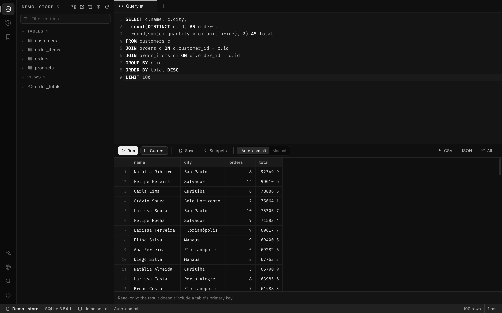
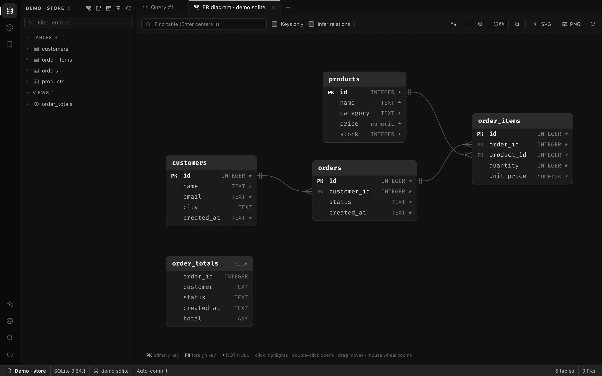
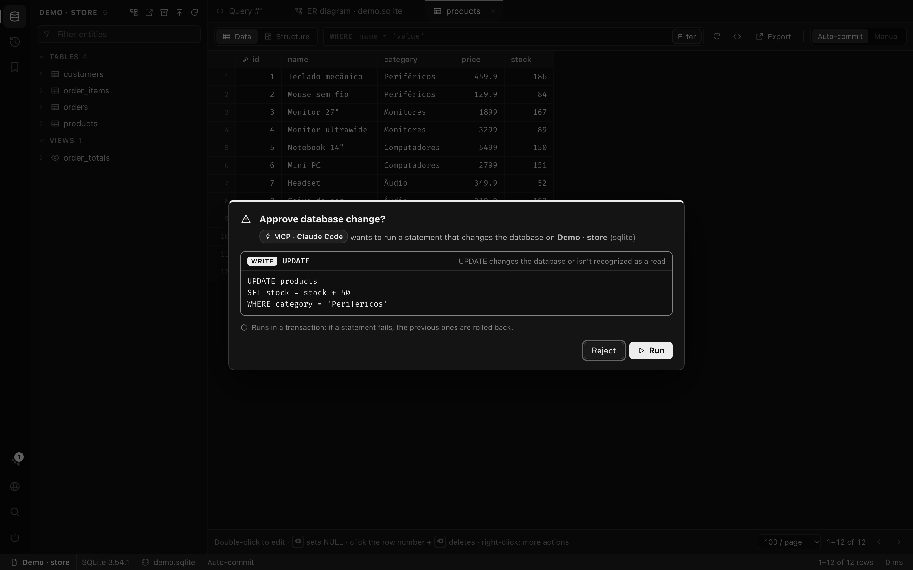
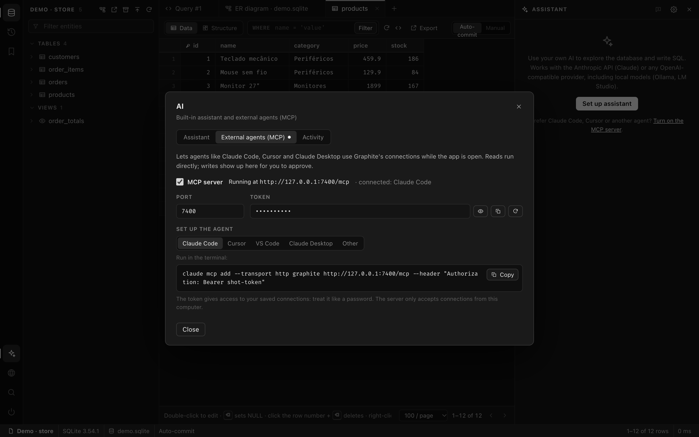

<p align="center">
  
</p>

<h1 align="center">Graphite</h1>

<p align="center">
  Cliente de banco de dados gratuito, open source e feito para o teclado, para <b>24 bancos de dados</b>: SQL, NoSQL e data warehouses na nuvem<br>
  no macOS, Windows e Linux, com assistente de AI e servidor MCP para os seus próprios agentes.
</p>

<p align="center">
  <a href="https://github.com/julioczn/graphite/releases/latest"></a>
  <a href="https://github.com/julioczn/graphite/actions/workflows/ci.yml"></a>
  <a href="LICENSE"></a>
  
</p>

<p align="center">
  <a href="https://julioczn.github.io/graphite/">Site</a> ·
  <a href="https://github.com/julioczn/graphite/releases/latest">Download</a> ·
  <a href="README.md">English</a>
</p>



## Recursos

- **SQLite, PostgreSQL, MySQL, MariaDB, TiDB, CockroachDB, GreengageDB e LibSQL/Turso** ([lista completa](#bancos-suportados)) com conexões salvas (senhas cifradas pelo chaveiro do sistema), botão
  **Testar**, **Importar de URL** (cole `postgres://…`, `mysql://…`, `mongodb+srv://…`, JDBC, `DATABASE_URL=…`, strings
  libpq ou ADO.NET e o formulário se preenche sozinho) e um banco **demo** pronto.
- **Editor SQL** (CodeMirror 6): autocomplete de tabelas e colunas, destaque da instrução atual, vários resultados por
  execução, erros inline. `⌘/Ctrl+Enter` executa tudo ou a seleção; `⌘/Ctrl+Shift+Enter`, a instrução sob o cursor.
- **Snippets de SQL**: digite um atalho (`sel`, `ij`, `ups`, `ct`…) e escolha no autocomplete; os modelos mudam por banco.
- **Navegação de tabelas**: paginação, ordenação, filtro `WHERE`, aba de estrutura (colunas, índices, DDL).
- **Edição inline** de tabelas e de resultados de consulta (quando a chave primária está no resultado), gravada numa
  única transação. Botão direito em células, cabeçalhos e linhas: copiar como valor / JSON / `INSERT`, definir `NULL`,
  filtrar pelo valor…
- **Gerar SQL** de qualquer tabela: `SELECT`, `SELECT` com `JOIN`s seguindo as FKs, `INSERT`, `UPDATE`, `DELETE`.
- **Auto-commit ou transação manual** por conexão, com commit/rollback (no PostgreSQL cada instrução roda num
  savepoint, então um erro não derruba a transação).
- **Diagrama ER** com layout automático, relações inferidas, busca, modo "só chaves" e exportação SVG/PNG.
- **Backup e restore** em `.sql` / `.sql.gz` sem `pg_dump` nem `mysqldump`, em streaming, com progresso e cancelamento.
- **Exportar** tabelas ou o resultado completo de uma consulta em CSV, JSON, JSON Lines ou `INSERT`s, sem limite de linhas.
- Histórico por conexão, consultas salvas, busca rápida (`⌘/Ctrl+P`), abas.
- **Português (Brasil), English e Español**: segue o idioma do sistema; troque quando quiser pelo ícone de globo.

<details>
<summary>Atalhos dos snippets</summary>

| Consulta | Joins | Alterar dados | Estrutura | Diagnóstico |
|---|---|---|---|---|
| `sel` `seld` `cnt` `grp` `pag` `busca` `entre` `cte` `case` `exists` `in` `rank` `dup` | `ij` `lj` `rj` `fj` `cj` `antij` `j3` | `ins` `insm` `inss` `insr` `ups` `upd` `updj` `del` `delj` `tx` | `ct` `addcol` `dropcol` `rencol` `idx` `uidx` `fk` `view` `drop` | `exp` `cols` `tam` `proc` |

`Tab` / `Shift+Tab` passam pelos campos e `Esc` sai. O botão **Snippets** da barra mostra todos com busca.
</details>

| Diagrama ER | Aprovando a alteração de um agente |
|---|---|
|  |  |

## Bancos suportados

| Banco | Status | Observações |
|---|---|---|
| SQLite | ✅ | Arquivos locais |
| PostgreSQL | ✅ | |
| MySQL | ✅ | |
| MariaDB | ✅ | |
| TiDB | ✅ | A AI pede aprovação para toda consulta (o TiDB não impõe transações somente leitura) |
| CockroachDB | ✅ | Sem o backup do Graphite (use o `BACKUP` do próprio CockroachDB) |
| GreengageDB | ✅ | |
| LibSQL / Turso | ✅ | URL remota + token; sem modo de transação manual |
| SQL Server / Azure SQL | ✅ | Decimais largos em consultas livres perdem precisão (limitação do driver); use `CAST` |
| Oracle Database | ✅ | Modo Thin (sem Instant Client); "banco" = nome do serviço |
| ClickHouse | ✅ | HTTP; sem transações (grade somente leitura); a AI lê com `readonly=1` |
| Trino / Starburst | ✅ | "Banco" = `catálogo` ou `catálogo.schema`; grade somente leitura |
| Firebird 3+ | ✅ | "Banco" = caminho ou alias no servidor |
| DuckDB | ✅ | Arquivo `.duckdb` local; a AI pede aprovação para toda consulta |
| Snowflake | 🧪 beta | Programmatic Access Token; grade somente leitura; ainda não testado numa conta real |
| BigQuery | 🧪 beta | Chave de conta de serviço (JSON); grade somente leitura; testado com o emulador open source |
| MongoDB | ✅ | Comandos no estilo do mongosh (`db.orders.find({…})`); filtro JSON; edição na grade mantém os tipos BSON |
| Redis / Valkey | ✅ | Comandos do redis-cli, um por linha; chaves exibidas e editadas por tipo (`MULTI/EXEC` atômico) |
| Apache Cassandra / ScyllaDB | ✅ | CQL; keyspaces no seletor; paginação sem total; edições num único batch logado |
| Amazon DynamoDB | ✅ | PartiQL; access key + secret (ou DynamoDB Local); edições numa transação, mantendo os tipos |
| SurrealDB | ✅ | SurrealQL via HTTP; namespace + banco; edições numa transação, mantendo os tipos |
| Amazon Redshift | 🧪 beta | Ainda não testado contra um cluster real |
| StarRocks | ✅ | Sem transações (grade somente leitura); a AI pede aprovação para toda consulta |

Nos não relacionais, a AI pede aprovação para todo comando, porque nenhum deles oferece um modo somente leitura em
que o app possa confiar. Todos têm edição pela grade; as colunas-chave (`_id`, chaves primária/de partição/de
ordenação, `id`) ficam somente leitura, porque identificam a linha.

## AI: use o seu próprio modelo ou agente

Dois jeitos de usar a sua própria AI, com as mesmas ferramentas por baixo (listar conexões, schemas e tabelas,
descrever tabela, resumo do schema com FKs, executar SQL):

- **Assistente embutido** (✦ na barra lateral): chat ao lado do editor com a **API da Anthropic** (Claude) ou qualquer
  provedor **compatível com OpenAI**, inclusive modelos locais (Ollama, LM Studio). Lê o schema, roda leituras sozinho,
  entrega o SQL com botões **Inserir** / **Nova aba**, e consultas com erro ganham o botão **Corrigir com AI**. A lista
  de modelos vem ao vivo do provedor. A chave de API fica cifrada no seu computador, uma por provedor, e nunca volta
  para a janela nem vai para outro provedor.
- **Servidor MCP** para agentes externos (Claude Code, Cursor, VS Code, Claude Desktop via `mcp-remote`): ligue em
  **AI e agentes → Agentes externos**, que mostra a configuração pronta para copiar. Só escuta em `127.0.0.1`, exige
  token e recusa requisições de navegador (`Origin`) ou com outro `Host`.



**Como os seus dados ficam protegidos** ([`electron/lib/aiquery.cjs`](electron/lib/aiquery.cjs)):

- **Leituras** (`SELECT`, `WITH`, `EXPLAIN`, `SHOW`…) rodam num modo somente leitura **imposto pelo próprio banco**
  (`BEGIN READ ONLY`, `SET SESSION TRANSACTION READ ONLY`, `PRAGMA query_only`), com timeout de 30 s e só as primeiras
  linhas lidas. Uma escrita disfarçada de leitura (`WITH … DELETE`, `EXPLAIN ANALYZE DELETE`, `nextval()`) falha em vez de rodar.
- **Qualquer outra instrução** abre uma **janela de aprovação** no Graphite mostrando quem pediu, a conexão e cada
  instrução. Aprovado, o script roda numa transação; recusado, nada roda e o agente é avisado. Conexões somente
  leitura nunca permitem escrita.
- Os agentes usam **sessões próprias**, nunca a sua transação aberta. Toda chamada aparece em **AI → Atividade**.

> [!IMPORTANT]
> Quem tiver o token do MCP consegue **ler** todas as conexões salvas sem pedir aprovação. Trate-o como uma senha e
> gere outro se ele vazar.

## Instalar

Baixe a versão mais recente em **[Releases](https://github.com/julioczn/graphite/releases/latest)**.

### macOS (Apple Silicon e Intel)

Abra `Graphite-<versão>-arm64.dmg` (Apple Silicon) ou `-x64.dmg` (Intel) e arraste o Graphite para Aplicativos.

O app tem assinatura ad-hoc, mas **não é notarizado** (sem Developer ID pago da Apple), então o Gatekeeper bloqueia a
primeira abertura. Vá em **Ajustes do Sistema → Privacidade e Segurança → Abrir Mesmo Assim**, ou rode:

```bash
xattr -dr com.apple.quarantine /Applications/Graphite.app
```

No Mac os atalhos usam `⌘` no lugar de `Ctrl` (a interface já mostra `⌘`), e a tecla `⌫` da grade faz o papel do `Del`.

### Windows (x64, Windows 10 ou 11)

Execute o `Graphite-Setup-<versão>.exe`. Ele instala só para o seu usuário (sem pedir administrador), deixa escolher a
pasta, cria atalhos no menu Iniciar e na área de trabalho, e as atualizações do app reinstalam em silêncio no mesmo
lugar. Ou descompacte o `Graphite-<versão>-win-x64.zip` portátil e rode o `Graphite.exe` (cópias portáteis não se
atualizam sozinhas).

O instalador ainda não tem assinatura de código, então o SmartScreen pode mostrar "O Windows protegeu o computador":
clique em **Mais informações → Executar assim mesmo**.

### Linux (x64)

```bash
sudo apt install ./graphite_<versão>_amd64.deb        # Debian, Ubuntu, Mint, Pop!_OS
sudo dnf install ./graphite-<versão>.x86_64.rpm       # Fedora, RHEL, Rocky, AlmaLinux, CentOS Stream
sudo pacman -U ./graphite-dbclient-<versão>-x86_64.pacman   # Arch, Manjaro, EndeavourOS
```

Os pacotes instalam em `/opt/Graphite` e criam o comando `graphite` e o atalho no menu; para remover, use
`apt remove graphite`, `dnf remove graphite` ou `pacman -R graphite-dbclient` (no Arch o nome `graphite` é da
biblioteca de fontes SIL Graphite). Cada um se atualiza pelo próprio gerenciador de
pacotes (pede a sua senha). Ou use o `Graphite-<versão>.AppImage` portátil (`chmod +x` e execute) em qualquer
distribuição. No Ubuntu 23.10+ o `.deb` cria um perfil do AppArmor (`/etc/apparmor.d/graphite`) para o sandbox do
Electron funcionar, como fazem VS Code e Chrome.

Toda versão passa por um teste antes de ser publicada: no macOS, no Windows (versão portátil e instalador) e no Linux,
onde os pacotes `.rpm`, pacman e `.deb` são instalados e abertos em contêineres limpos de Rocky Linux 9, Fedora, Arch e
Ubuntu.

### TLS / SSL

Com **Usar SSL**, escolha como o certificado do servidor é verificado: *só criptografar*, *verificar a CA* ou
*verificar a CA e o nome do host* (o padrão para conexões novas). Aponte o **certificado da CA** (sem ele, valem as
autoridades confiáveis do sistema) e, para TLS mútuo, o **certificado e a chave do cliente** (arquivos PEM; o Graphite
guarda só os caminhos). O Firebird criptografa o próprio protocolo; o MongoDB recebe as opções de TLS na URL de
conexão (`tls=true&tlsCAFile=…`).

### Túnel SSH

Para um banco atrás de um bastion, marque **Conectar por um túnel SSH** e informe o servidor SSH, o usuário e como
entrar: **chave privada** (vazio = `~/.ssh/id_ed25519`, `id_ecdsa` ou `id_rsa`; a passphrase, se tiver), **senha** ou
o **agente SSH**. O host e a porta do banco passam a ser os vistos a partir do servidor SSH (`localhost` se o banco
roda nele). O TLS continua conferindo o certificado pelo nome real do host. A chave do servidor SSH é registrada na
primeira conexão e uma chave diferente é recusada. Funciona com todo banco acessado por host e porta, e com o MongoDB
numa URL `mongodb://` (um host). A senha ou passphrase é salva cifrada como a senha do banco e nunca vai para o GitHub;
a importação de outras ferramentas traz os dados do túnel junto.

### Atualizações

O Graphite consulta as releases deste repositório ao abrir e a cada 6 horas, mostra **Atualização disponível** na
barra lateral e baixa e instala a versão nova para você: o arquivo é conferido com o SHA-256 que o GitHub publica e o
Graphite reinicia já na versão nova (`.app` no macOS, AppImage ou `.deb` via `pkexec`). A verificação automática pode
ser desligada no mesmo diálogo; ela é uma consulta simples à API do GitHub, sem nada sobre você ou seus bancos.

### Workspaces e sincronização com o GitHub

Um **workspace** reúne conexões salvas, consultas salvas, os seus próprios snippets, as abas deixadas abertas em cada
conexão e as preferências por conexão (modo de commit, último schema). Escolha ou crie um no topo da tela de conexões;
o que você já tinha está no primeiro.

- **Exportar / importar** um workspace em YAML ou JSON, no mesmo menu. Importar cria um workspace novo.
- **Sincronizar com o GitHub**: ligue um workspace a uma pasta num repositório *privado* seu, entrando com o GitHub ou
  com um token "fine-grained" que só escreve no conteúdo desse repositório. O workspace vira arquivos legíveis
  (`<pasta>/workspace.yml`, `<pasta>/queries/*.sql`, um commit por sincronização). O Graphite sincroniza ao abrir, a
  cada 10 minutos e logo depois de uma mudança. Uma consulta editada em duas máquinas ao mesmo tempo mantém as duas
  versões em vez de sobrescrever uma. O estado da sincronização (sincronizado, sincronizando, falhou, desconectado)
  aparece embaixo do seletor de workspace e na barra de status.
- **Importar de outras ferramentas**: o Graphite encontra as conexões salvas no DBeaver, DataGrip / IntelliJ,
  Beekeeper Studio, TablePlus, pgAdmin 4, MySQL Workbench, Sequel Ace / Sequel Pro, DbGate, MongoDB Compass,
  RedisInsight e VS Code SQLTools / Azure Data Studio deste computador, ou lê um arquivo que você escolher (também
  Navicat `.ncx` e configurações exportadas do HeidiSQL). Você escolhe quais conexões trazer, para o workspace atual
  ou um novo. As senhas salvas vêm junto quando a ferramenta as guarda nos próprios arquivos (DBeaver, Beekeeper,
  DbGate, Navicat, HeidiSQL); as que estão no chaveiro do sistema ficam lá. Scripts do DBeaver e favoritas do
  Beekeeper viram consultas salvas. Túneis SSH ainda não são suportados e aparecem sinalizados.
- **Senhas e tokens nunca saem do seu computador**: ficam fora das exportações e do repositório. Em outra máquina você
  digita cada senha uma vez. Repositórios públicos são recusados.

### Onde ficam os seus dados

Conexões salvas, histórico e configurações ficam no seu computador: `~/Library/Application Support/Graphite` (macOS)
ou `~/.config/Graphite` (Linux). O Graphite não tem telemetria; ele só conversa com os seus bancos, com o seu provedor
de AI (se você configurar) e com o GitHub para verificar atualizações (dá para desligar) e, se você ligar um
workspace, para sincronizá-lo.

## Compilar a partir do código

Precisa de **Node.js 22+**.

```bash
git clone https://github.com/julioczn/graphite.git
cd graphite
npm install
npm run dev        # Vite com HMR + Electron
npm start          # build do renderer + Electron
npm run dist:mac   # release/Graphite-<versão>-{arm64,x64}.dmg e .zip (num Mac)
npm run dist       # release/Graphite-<versão>.AppImage e graphite_<versão>_amd64.deb
npm run i18n:check # cobertura das traduções
```

`GRAPHITE_PROFILE_DIR=/outra/pasta npm start` roda com um perfil separado (configurações, conexões, demo), útil para testes.

### Estrutura

```
electron/
  main.cjs        janelas, diálogos, safeStorage, processo utility + MessagePorts
  preload.cjs     window.graphite: RPC via MessagePort + IPC em whitelist
  utility.cjs     processo de banco: handlers conn/*, query/*, table/*, app/*
  ai/             hub (ferramentas, sessões dos agentes, aprovações), mcp (servidor), assistant (chat)
  drivers/        sqlite, postgres (pg), mysql (mysql2), libsql, mssql (tedious), oracle (oracledb),
                  clickhouse, trino, firebird (node-firebird), duckdb (@duckdb/node-api),
                  snowflake, bigquery, mongodb, redis (ioredis), cassandra (cassandra-driver), dynamodb, surrealdb
  lib/            banco do app, demo, backup/restore/exportação, guarda de leitura das consultas da AI
shared/
  engines.mjs     engines de banco: família, padrões e capacidades
  sql.mjs         separador de instruções (utility e renderer)
  i18n.mjs        traduções de todos os processos + locales/en.mjs, locales/es.mjs
src/              renderer Vue 3 (components/, lib/)
docs/             site (GitHub Pages) e screenshots
```

Todo acesso a banco acontece num processo separado que fala com a janela por um `MessagePort`; a janela roda em
sandbox, com isolamento de contexto e sem acesso ao Node.js.

## Traduções

O texto em português é a própria chave: `t('Nova conexão')`, `t('Tabela {name}', { name })`, plural com
`t('{n} linha|{n} linhas', { n })`. Inglês e espanhol ficam em [`shared/locales`](shared/locales). Para um novo
idioma, copie `en.mjs`, traduza os valores e registre em [`shared/i18n.mjs`](shared/i18n.mjs);
`npm run i18n:check` mostra o que falta. Correções de falantes nativos são muito bem-vindas.

## Contribuindo

Issues e pull requests são bem-vindos. Veja o [CONTRIBUTING.md](CONTRIBUTING.md). Para falhas de segurança, siga o
[SECURITY.md](SECURITY.md) em vez de abrir uma issue pública.

## Licença

[MIT](LICENSE) © Julio Zimmermann
